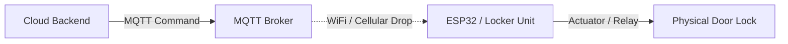
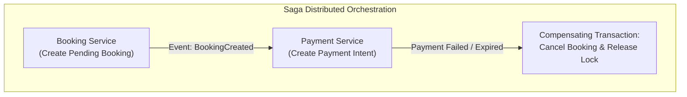

# Edge Cases & Architectural Solutions for IoT Smart Lockers & Microservices

This document compiles the exhaustive edge cases, failure modes, race conditions, and real-world system pitfalls encountered when designing and operating **IoT-enabled Smart Locker Systems** and **Event-Driven Microservices Architectures**, along with concrete, production-grade solutions.

---

## Table of Contents
1. [IoT, Hardware & Network Edge Cases](#1-iot-hardware--network-edge-cases)
2. [Concurrency, Booking & State Machine Edge Cases](#2-concurrency-booking--state-machine-edge-cases)
3. [Payment & Financial Transaction Edge Cases](#3-payment--financial-transaction-edge-cases)
4. [Distributed Microservices & Data Consistency Edge Cases](#4-distributed-microservices--data-consistency-edge-cases)
5. [User Experience (UX), Human Factors & Physical Edge Cases](#5-user-experience-ux-human-factors--physical-edge-cases)
6. [Security, Auth & Abuse Edge Cases](#6-security-auth--abuse-edge-cases)

---

## 1. IoT, Hardware & Network Edge Cases



### 1.1 Command Loss During Hardware Offline (Device Offline when Unlock is Triggered)
- **Scenario**: A user completes payment and presses **Unlock Locker**, but the physical locker station just lost cellular/WiFi connectivity. The MQTT broker drops the message or holds it indefinitely.
- **Risk**: User is standing in front of the locker with luggage; locker does not open; user assumes money is lost.
- **Solution**:
  1. **QoS 1 with Expiring Retention**: Publish MQTT commands with `QoS=1` and an MQTT v5 message expiry interval (e.g., 60 seconds). Do not allow commands to execute 2 hours later when connectivity restores.
  2. **Offline Emergency PIN / OTP Fallback (TOTP / HMAC)**: At the time of booking creation, the backend and firmware share a deterministic time-based algorithm or one-time rolling code. If the device is offline, the user app displays an offline PIN keypad code that the hardware keypad verifies locally without internet.
  3. **Client-side Polling & ACK**: The frontend shows an unlocking spinner with a 15-second timeout waiting for a device `door_opened` event. If no ACK arrives, the UI informs the user and provides an immediate "Retry" or "Emergency Operator Override".

### 1.2 Door Jam / Mechanical Actuator Failure
- **Scenario**: The relay/solenoid clicks to unlock, but the physical door is mechanically jammed, obstructed by oversized luggage inside, or swollen due to humidity/rust.
- **Risk**: Backend marks the locker as unlocked or released, but the user cannot open the door.
- **Solution**:
  - **Hardware Magnetic Reed Sensor**: Do not treat the command transmission as success. Separate `command_sent` from `door_opened`. The door sensor must physically report open circuit (`door_open`).
  - **Auto-Pulse Retry**: Firmware attempts 3 quick solenoid pulses (150ms intervals) before declaring an actuator error.
  - **Mechanical Exception Event**: If the sensor does not report open within 5 seconds of actuation, the device emits an MQTT event `err:door_jammed`. The server catches this, flags the locker as `offline_maintenance`, and either prompts the user to choose an alternative adjacent locker automatically or issues an immediate refund.

### 1.3 Door Left Ajar / Forgotten Door Open
- **Scenario**: The user retrieves their item and walks away, but pushes the door insufficiently, leaving the latch open.
- **Risk**: Next user arrives and sees an open locker, or someone steals future items; system thinks locker is occupied.
- **Solution**:
  - **Hardware Buzzer / LED Warning**: After 60 seconds of open state post-unlock, the device sounds a localized audio chirp and flashes an LED indicator.
  - **Push Notification & Timeout Escalation**: Backend triggers an automated SMS/Push alert to the user: *"Your locker #102 is still open. Please push firmly to lock."*
  - **Auto-Release Policy**: If the door remains open for > 5 minutes without motion, mark the locker status as `maintenance_required` so the discovery engine never assigns it to another traveler until an attendant verifies it.

### 1.4 Power Outage & Dirty Reboots
- **Scenario**: The locker controller loses mains power abruptly and reboots on backup battery or power restoration.
- **Risk**: In-memory firmware state is lost; lockers might pop open or remain locked during a brownout.
- **Solution**:
  - **Normally-Closed (Fail-Secure) Solenoid Locks**: Solenoids must require active power pulse to retract. If power fails completely, doors remain securely locked (fail-secure, not fail-open).
  - **Non-Volatile EEPROM / Flash State**: The controller records the state of all locker latches in flash memory before state changes. On bootup, the device publishes a `status_sync` telemetry payload reporting the sensor state of every door to the MQTT broker.

---

## 2. Concurrency, Booking & State Machine Edge Cases

```mermaid
sequenceDiagram
    autonumber
    actor Alice
    actor Bob
    participant DB as MySQL DB
    Alice->>DB: SELECT * FROM lockers WHERE code='CH101' FOR UPDATE SKIP LOCKED
    Note over DB: Lock granted to Alice
    Bob->>DB: SELECT * FROM lockers WHERE code='CH101' FOR UPDATE SKIP LOCKED
    Note over DB: Row locked; Bob gets empty set (0 rows)
    DB-->>Alice: 1 Row Returned (Holds Locker)
    DB-->>Bob: 0 Rows Returned (HTTP 409 NO_LOCKER_AVAILABLE)
```

### 2.1 "Thundering Herd" on the Last Available Locker
- **Scenario**: 100 travelers exit a train simultaneously and all request the single remaining Medium locker at a station within the same 50 milliseconds.
- **Risk**: Double-booking, deadlocks, 500 server crashes.
- **Solution**:
  - **Transactional Row-Level Lock with `SKIP LOCKED`**:
    ```sql
    SELECT id, locker_code FROM lockers 
    WHERE location_id = :loc_id AND size = :size AND status = 'free' 
    LIMIT 1 FOR UPDATE SKIP LOCKED;
    ```
    Only the first incoming transaction locks the row; the remaining 99 requests immediately see 0 available rows without waiting in a blocking queue, cleanly returning HTTP 409 `NO_LOCKER_AVAILABLE` in under 10ms.
  - **Idempotency Keys**: Clients send a UUID `Idempotency-Key` header with every hold request to prevent duplicate creation if the user taps "Book" multiple times rapidly.

### 2.2 Payment Webhook Arriving After Hold Expiration (The "Ghost Payment")
- **Scenario**: A user creates a 15-minute hold on Locker `CH101`. At minute 14:55, they submit payment on Razorpay. The user takes 10 seconds to authorize an OTP in their bank app. At minute 15:00, the server background worker runs and marks the booking `EXPIRED`, freeing Locker `CH101`. At minute 15:05, Razorpay fires `payment.captured`. Meanwhile, another user just grabbed `CH101` at minute 15:02!
- **Risk**: User paid real money, but their locker was already assigned to someone else.
- **Solution**:
  1. **Two-Stage Validation in Webhook Handler**:
     When the webhook arrives for an expired booking, check if the original locker is still `free`.
     - **If still free**: Gracefully resurrect the booking: `EXPIRED -> PAID`, re-hold the locker, and extend the duration.
     - **If already taken by another user**: Do not overwrite the new occupant! Keep the old booking as `PAYMENT_UNASSIGNED`, immediately issue an automated API refund via Razorpay refund API (`POST /v1/payments/{id}/refund`), and send an SMS explaining: *"Locker hold expired before payment finalized. Your payment has been refunded in full."*
  2. **Hold Buffer Window**: Expiry workers should check for bookings expired by `now() - INTERVAL 60 SECOND` to allow in-flight bank webhooks to arrive before declaring total forfeiture.

### 2.3 Out-of-Order Webhook Delivery
- **Scenario**: Network latency causes the webhook `payment.failed` or `payment.authorized` to arrive *after* `payment.captured`.
- **Risk**: A paid booking is accidentally regressed to unpaid or cancelled.
- **Solution**:
  - **Strict State Machine Guards**: Transitions must only follow directed acyclic graphs:
    `CREATED -> PAID -> STORED -> RELEASED`.
    If current state is `PAID`, any incoming event for `FAILED` or `CREATED` is rejected as an illegal transition and ignored idempotently.

---

## 3. Payment & Financial Transaction Edge Cases

### 3.1 Network Disconnect Right After Payment Authorization
- **Scenario**: The user pays through UPI/Credit Card in the browser. The bank charges their card, but the user's phone drops cellular signal before Razorpay's JavaScript SDK can return the response to the frontend page.
- **Risk**: Frontend displays an error or stays on the checkout page; user panics thinking money was lost without a booking.
- **Solution**:
  - **Server-to-Server Webhooks as Single Source of Truth**: Never trust the frontend client redirect to mark a booking `PAID`. Only the cryptographically signed `payment.captured` webhook from Razorpay/Stripe transitions the booking to `PAID`.
  - **Reconnection Polling & Sync**: When the frontend regains network connectivity or the user re-opens the app, it hits `GET /v1/bookings/{id}`. Because the webhook already processed on the server, the app immediately shows the `PAID` active locker screen.

### 3.2 Duplicate Webhook Ingestion (At-Least-Once Delivery)
- **Scenario**: Payment providers guarantee *at-least-once* delivery. If their server does not get an HTTP 200 within 3 seconds, they retry the same webhook 5 times.
- **Risk**: Duplicate database records, multiple booking extensions, or sending redundant unlock commands.
- **Solution**:
  - **Database Unique Constraint on Gateway Event ID**:
    `payments.gateway_event_id VARCHAR(100) UNIQUE`.
    The webhook handler runs inside an atomic transaction:
    ```sql
    INSERT INTO payments (gateway_event_id, booking_id, amount_paise) VALUES (...);
    ```
    If `gateway_event_id` already exists, catch the unique violation, immediately return HTTP 200 OK (so the provider stops retrying), and make zero changes to state.

---

## 4. Distributed Microservices & Data Consistency Edge Cases



### 4.1 Distributed Dual-Write Problem
- **Scenario**: In a microservice setup, Booking Service updates its MySQL database, then sends a Kafka/RabbitMQ message to notify Payment Service. If the service crashes right between writing the database and pushing to the queue, the message is never sent.
- **Risk**: Database and message broker become permanently out of sync.
- **Solution**:
  - **Transactional Outbox Pattern**: Do not write directly to the message broker in your API handler. Instead, write both the domain entity (`bookings`) and an `outbox_events` record in the **same atomic database transaction**. A separate Debezium CDC (Change Data Capture) or background polling worker reads `outbox_events` and publishes them to the message broker with guaranteed delivery.

### 4.2 Partial Failures & Compensating Transactions (Sagas)
- **Scenario**: Booking Service holds a locker, but Payment Service fails to generate an invoice due to a gateway timeout.
- **Solution**:
  - **Saga Pattern**: Instead of distributed locking across microservice boundaries, use orchestrator- or choreography-based sagas with explicit compensating transactions (`CancelBookingCompensation`) to clean up held resources if any step in the pipeline fails.

### 4.3 Database Schema Drift Across Microservices
- **Scenario**: The Booking microservice assumes locker code is always alphanumeric `[A-Z]{2}[0-9]{3}`, but Inventory microservice deploys a schema allowing special station characters (e.g. `BLR-C-101`).
- **Solution**:
  - **Consumer-Driven Contract Testing (Pact / OpenAPI Spec Validation)**: Automated CI/CD pipelines run contract validation tests (`test_contract.py`) against shared OpenAPI and protobuf schemas before any service container is allowed into staging or production.

---

## 5. User Experience (UX), Human Factors & Physical Edge Cases

### 5.1 Traveler Arrives Late (Overstay)
- **Scenario**: Traveler books for 2 hours, goes to a meeting, and gets stuck in traffic. The 2 hours elapse while their laptop is still locked inside.
- **Risk**: Another user books the same locker; doors open for someone else; luggage gets mixed up.
- **Solution**:
  1. **Grace Period & State Transition to `OVERSTAY`**: When `ends_at` passes, the booking moves to `OVERSTAY`. The locker is **never released** to the public pool while items remain inside!
  2. **Hourly Penalty Billing**: The system charges an incremental overstay fee (e.g., 1.5x hourly rate).
  3. **Conditional Settlement on Retrieval**: When the user finally taps "Unlock", the app calculates the penalty, prompts for the remaining balance payment, and unlocks once settled.

### 5.2 Accidental Early Door Close During Loading (The "Empty Lockout")
- **Scenario**: User unlocks their empty locker, starts to put luggage in, but accidentally bumps the door shut before placing items inside. The door sensor registers `door_closed` and advances to `STORED`.
- **Risk**: User is locked out of their paid locker with their belongings still outside!
- **Solution**:
  - **Multi-Unlock Allowance During First 5 Minutes**: While a booking is in `STORED` state, permit unlimited re-unlocks during the first 5 minutes without penalty, provided the user's phone is within 50 meters.
  - **Weight / Optical Sensor Integration**: Advanced lockers use internal infrared beam break or floor load sensors to detect whether luggage was actually placed inside before finalizing storage state.

### 5.3 Physical Tamper / Forced Entry
- **Scenario**: Someone attempts to pry open a locker door with a crowbar while it is locked.
- **Risk**: Theft of user goods, property damage.
- **Solution**:
  - **Tamper Switch Detection**: Hardware incorporates an internal microswitch behind the door frame. If the circuit opens without a preceding valid unlock command, the firmware triggers an emergency MQTT packet:
    `lockers/{id}/evt -> {"type": "tamper_detected", "timestamp": ...}`
  - **Automated Escalation**: Backend immediately alerts security staff via SMS/PagerDuty, activates the locker station's physical siren/strobe, and locks down adjacent units.

---

## 6. Security, Auth & Abuse Edge Cases

### 6.1 SMS Flooding / OTP Toll Fraud
- **Scenario**: An attacker scripts calls to `POST /v1/auth/otp/request` with hundreds of international premium-rate numbers, running up thousands of dollars on your Twilio bill.
- **Risk**: Massive financial API bills and SMS gateway suspension.
- **Solution**:
  1. **Strict Rate Limiting by IP and Phone Number**: Max 3 OTP requests per phone per 10 minutes; max 10 requests per client IP per hour.
  2. **Geo-IP and Country Code Whitelist**: Restrict phone numbers to authorized service territories (e.g., allow only `+91` if operating in India).
  3. **Invisible Bot Defense**: Require Cloudflare Turnstile / CAPTCHA validation on the web client before dispatching carrier SMS requests.

### 6.2 Locker Hoarding (Denial of Inventory)
- **Scenario**: A malicious competitor creates 20 accounts using virtual numbers, reserves all available lockers at a station, and lets them sit unpaid for 15 minutes each round.
- **Risk**: Real travelers cannot find any open lockers; business loses revenue.
- **Solution**:
  - **Active Hold Quota**: Limit each phone number to at most **one** unpaid `CREATED` hold at any given time across the entire system.
  - **Progressive Hold Throttling**: If a user account allows 2 consecutive holds to expire without payment, enforce a 30-minute cooldown period before allowing them to hold another locker.

---

## Summary Matrix of Critical Edge Cases

| Edge Case Category | Primary Failure Mode | Architectural Defense |
| :--- | :--- | :--- |
| **Hardware** | Station offline when user wants to unlock | Offline TOTP / Keypad PIN fallback + QoS 1 message expiration |
| **Hardware** | Door jam / Solenoid failure | Reed switch confirmation + auto-pulse retry + failure redirect |
| **Concurrency** | Hundreds race for the last locker | `SELECT ... FOR UPDATE SKIP LOCKED` + unique constraint |
| **Financial** | User pays after the 15-min hold expired | Two-stage webhook check: resurrect hold if free, auto-refund if taken |
| **Financial** | Duplicate payment webhook events | Database unique constraint on `gateway_event_id` (idempotency) |
| **Microservices** | Broker down after DB write | Transactional Outbox Pattern |
| **Human / Physical**| User overstays booked hours | State machine moves to `OVERSTAY`; never free locker until door confirms empty |
| **Security** | Scripted SMS OTP draining | Country whitelisting + rate limiting + Bot challenge gates |

*(Document prepared for architectural reference; not committed to version control)*
